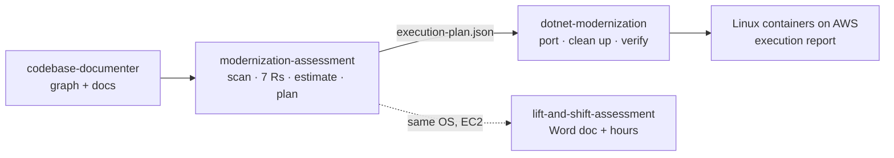

<div align="center">

# Skills

**Production-grade Agent Skills for Claude Code, Codex, Cursor and GitHub Copilot.**
<br>One command installs them, and Claude picks the right one on its own.

[](#skills)
[](#supported-agents)
[](https://nodejs.org)
[](https://www.python.org)
[](#requirements)
[](https://platform.claude.com/docs/en/agents-and-tools/agent-skills/best-practices)

```bash
npx -y github:MayankPunghal/Skills
```

**[Skills](#skills)** · **[Which skill?](#which-skill-do-i-need)** · **[.NET to AWS](#the-net-to-aws-family)** · **[Install](#quick-start)** · **[Installer](#installer-reference)** · **[Publish your own](#publishing-a-skill)**

New here? The one-page **[Quick start](QUICKSTART.md)** covers install and the three main skills.

</div>

---

## Contents

- [Skills](#skills)
- [Which skill do I need?](#which-skill-do-i-need)
- [The .NET to AWS family](#the-net-to-aws-family)
- [Skill guide](#skill-guide)
  - [codebase-documenter](#codebase-documenter)
  - [modernization-assessment](#modernization-assessment)
  - [dotnet-modernization](#dotnet-modernization)
  - [lift-and-shift-assessment](#lift-and-shift-assessment)
  - [gh-review-pr](#gh-review-pr)
  - [skill-publisher](#skill-publisher)
- [Quick start](#quick-start)
- [Requirements](#requirements)
- [Installer reference](#installer-reference)
- [How it works](#how-it-works)
- [Supported agents](#supported-agents)
- [Claude app and phone](#claude-app-and-phone)
- [Publishing a skill](#publishing-a-skill)
- [Troubleshooting](#troubleshooting)
- [Repository layout](#repository-layout)
- [Contributing](#contributing)

## Skills

| Skill | What it does | Bundles |
|---|---|---|
| [**codebase-documenter**](skills/codebase-documenter/SKILL.md) | Documents an existing codebase end to end, in any language. It builds a knowledge graph, an exhaustive cross-linked reference and narrative docs (architecture with C4, workflows, data model, security findings), then an offline searchable MkDocs site and an agent layer (`AGENTS.md`, project skill, `llms.txt`). | 14 commands · Python scripts · templates · prerequisite installer |
| [**dotnet-modernization**](skills/dotnet-modernization/SKILL.md) | Carries out the modernization of legacy .NET Framework applications to .NET 10 on Linux containers on AWS, after an assessment. One porting engine per project (AWS DevTx Version Upgrade Toolkit or AWS Transform for .NET), then Claude cleans up what the engine left, playbook by playbook, and pass/fail gates prove the result. | 14 commands · 17 clean-up playbooks · residue scan (69 rules) · Linux readiness (337 checks) · parity replay · execution report · bundled DevTx .NET knowledge base |
| [**gh-review-pr**](skills/gh-review-pr/SKILL.md) | Reviews a GitHub pull request, or local changes since a commit, on three separate axes: quality (bugs, security, design, performance), the repo's documented standards plus a code-smell baseline, and the spec (linked issue or spec file). Every finding has the issue, possible fixes, the risk if not addressed and an impact × likelihood rating. Writes an HTML review report and can post inline PR comments. | 6 Node scripts · review lenses + smell baseline · spec checklist · HTML report · findings cache · inline posting |
| [**lift-and-shift-assessment**](skills/lift-and-shift-assessment/SKILL.md) | Produces a draft AWS lift-and-shift (Windows to Windows, EC2) assessment for a .NET estate of any size: one Word document for the whole project, a small companion workbook, and an estimate in developer working hours, solution by solution. | 11-step workflow · ~50-question intake · build check · hours model · Word + Excel output |
| [**linux-readiness**](skills/linux-readiness/SKILL.md) | Checks a .NET code base for everything that works on Windows but breaks or behaves differently in a Linux container on AWS (ECS, EKS, Fargate), and says how to fix each hit. Works before a port, after one, and on apps already on .NET 5+. Read-only, masks secrets. | 337 checks in 19 areas · JSON + Markdown + HTML report · build gate with waivers · Dockerfile-only mode · self-test |
| [**modernization-assessment**](skills/modernization-assessment/SKILL.md) | Assesses legacy .NET estates (one repo or hundreds) for modernization to .NET 10, Linux and AWS. It scans for everything that breaks on Linux or .NET 10, classifies apps with the 7 Rs, estimates effort, and writes a client-ready report (Markdown, interactive HTML, JSON/CSV). Ends with an execution plan for dotnet-modernization. | 170+ detection rules · Linux readiness (337 checks) · raw SQL inventory · AWS managed-service map · estimation model · report templates · worked sample |
| [**skill-publisher**](skills/skill-publisher/SKILL.md) | Takes any skill folder or zip, refactors it to the [conventions](CONVENTIONS.md) without dropping content, validates it, scans it for secrets, pushes it to this repo and installs it with its prerequisites. | Staging · secret scan · validator gate · git automation |

Every skill is **self-contained**: scripts, templates and data ship inside the skill folder, so it works on any machine where it's installed. Every skill is also **model-invocable**: Claude reads the descriptions and uses a skill when a request fits, or you call it by name (`/codebase-documenter`). Type a skill's name on its own (`/modernization-assessment`) to see its menu and the recommended next step.

## Which skill do I need?

| You want to… | Use | Start with |
|---|---|---|
| Understand or hand over an unfamiliar codebase | **codebase-documenter** | `/codebase-documenter full run on C:\code\MyApp` |
| Know what it takes to move .NET apps to AWS and Linux, with hours and a plan | **modernization-assessment** | `/modernization-assessment assess the estate at C:\code\MyApp` |
| Actually port the apps the assessment planned | **dotnet-modernization** | `/dotnet-modernization modernize-package <name>` |
| Check an app already on .NET 5+ for Linux containers | **linux-readiness** (also inside dotnet-modernization and modernization-assessment) | `/linux-readiness scan C:\code\MyApp` |
| Move Windows servers to EC2 as they are, with an hours estimate | **lift-and-shift-assessment** | `/lift-and-shift-assessment` |
| Review a pull request or your local changes | **gh-review-pr** | `/gh-review-pr 42` |
| Add, clean up or update a skill in this collection | **skill-publisher** | `/skill-publisher C:\path\to\my-skill` |

## The .NET to AWS family

Four skills work as one pipeline. Each writes files the next one reads, so a later session (or a colleague) picks up where the last one stopped.



| Stage | Skill | What it decides or does | Hand-off file |
|---|---|---|---|
| Map | codebase-documenter | Knowledge graph and call graph the assessment reads for reachability | `graphify-out/` |
| Assess and plan | modernization-assessment | What breaks, the 7R per app, effort and timeline, and per package: **one porting engine** (DevTx or AWS Transform), **one database tool**, the clean-up playbooks, libraries first | `assessment/execution-plan.json` |
| Execute | dotnet-modernization | Runs the chosen engine, Claude clean-up one playbook per commit, SQL Server → PostgreSQL in the code, AWS managed-service swaps, the container, then the gates | `.modernization/execution-report.html` |
| Same-OS move | lift-and-shift-assessment | Windows-to-Windows on EC2 when modernizing is out of scope | `<client>-lift-and-shift-assessment.docx` |

Installing modernization-assessment brings codebase-documenter with it. modernization-assessment, dotnet-modernization and linux-readiness ship the same Linux readiness check (337 checks), so an app already on modern .NET gets the same answer from any of them; linux-readiness is the check on its own.

## Skill guide

### codebase-documenter

Turns a codebase you don't know into a website you can read offline, plus a layer that lets an AI agent answer questions about it with `file:line` evidence.

- **Try:** `/codebase-documenter full run on C:\code\MyApp` (run it from an empty folder for the docs, not inside the code).
- **You get:** `site/index.html` with architecture (C4), business modules, workflows, data model, security findings and a full cross-linked reference; a zip in `publish/`; `AGENTS.md`, `CLAUDE.md`, a project skill `<name>-docs` and `llms.txt`.
- **Stages:** `install-prerequisites` → `setup-workspace` → `build-code-graph` → `survey-codebase` → `research-area` → `generate-reference` → `write-pages` → `build-site` → `verify-docs` → `make-agent-skill` → `package-docs`; later `update-docs` and `resume`.
- **Needs:** Python 3.10+, MkDocs Material and graphify (the prerequisite installer handles them). An LLM key is optional, only to name code areas.
- **Details:** [SKILL.md](skills/codebase-documenter/SKILL.md) · [Quick start](QUICKSTART.md#document-a-codebase-codebase-documenter).

### modernization-assessment

Assesses and plans; it never changes code. Works for one repository or hundreds.

- **Try:** `/modernization-assessment assess the estate at C:\code\MyApp, workspace C:\work\myapp-assessment`.
- **It asks first:** the target (modernize to .NET 10 on Linux, or lift-and-shift with the same OS) and the database plan (SQL Server + PostgreSQL, PostgreSQL only, or no change).
- **It finds:** Windows-only APIs, System.Web and Web Forms, WCF, COM, registry, MSMQ, auth/AD/machineKey, config secrets (names only), hard-coded hosts and UNC paths, letter case and path issues, time zones, SQL Server features against PostgreSQL, raw SQL in the code, server-hosted services with their AWS managed options, vulnerable NuGet packages, and 240 Linux readiness checks.
- **You get:** a client-ready report (interactive HTML, Markdown, JSON/CSV) with a justified 7R decision per application, effort and timeline with ranges, risks and open questions, and `execution-plan.json` for dotnet-modernization.
- **Steps:** `intake` → `discover-estate` → `map-code-graph` → `scan-repos` → `linux-readiness` → `map-infra` → `review-findings` → `classify-applications` → `estimate-effort` → `plan-execution` → `write-report` → `verify-report`; or `assess-estate` for all of them, `resume` to continue.
- **Tip:** pass `--prepared-by "Your Company"` (or set `ASSESSMENT_PREPARED_BY`) to put your name on the report.
- **Details:** [SKILL.md](skills/modernization-assessment/SKILL.md) · [README](skills/modernization-assessment/README.md).

### dotnet-modernization

Executes the plan, one package at a time, on a branch of a copy of the code. Never pushes to a client remote.

- **Try:** `/dotnet-modernization modernize-package OrderService`, or `/dotnet-modernization` for where the run is and the next step.
- **How it works:**
  1. **One porting engine per project:** the AWS DevTx Version Upgrade Toolkit (Upgrade Assistant + Kiro + a .NET knowledge base) or AWS Transform for .NET. Never both. Claude is the engine only when neither is available.
  2. **Claude cleans up** what the engine left, one playbook per commit: System.Web residue, handlers and modules, Web Forms to Blazor or Razor Pages, ASMX and WCF, startup and middleware, config and secrets, auth, Windows-only APIs, background work, time and culture, logging, Linux and containers, AWS managed services, raw SQL and data access.
  3. **One database tool** for SQL Server → PostgreSQL in the code: the DB porting agent, or Claude with the DB porting skills.
  4. **Gates:** build, tests, residue (69 rules), Linux readiness (337 checks), container start and health, and response parity against the original.
- **Order:** shared libraries first (multi-targeting, System.Web adapters), then applications. Apps already on .NET 5+ get the Linux readiness path only.
- **You get:** a commit per step, a run log and `execution-report.md` + `.html` (gates, residue left and waived, parity, planned items done or open).
- **Needs:** .NET 10 SDK and Docker; the chosen engine (DevTx toolkit or the `atx` CLI); `install_prerequisites.py --check` reports what is missing and installs nothing without asking.
- **Details:** [SKILL.md](skills/dotnet-modernization/SKILL.md) · [README](skills/dotnet-modernization/README.md) · [playbooks](skills/dotnet-modernization/reference/playbooks/README.md) · [engines](skills/dotnet-modernization/reference/engines.md).

### lift-and-shift-assessment

A draft assessment for moving Windows workloads to EC2 as they are (no C# change), laid out like a reference plan document.

- **Try:** `/lift-and-shift-assessment`; it shows the state and the next step.
- **It asks first:** about 50 multiple-choice questions (engagement, environments, hosting, waves, CI/CD, secrets, testing); scan-dependent questions appear only when the scan finds the thing they ask about. Nothing is assumed.
- **It finds:** solutions and deployables, environment variables, hard-coded addresses, third-party and licensed components, scheduled jobs, build blockers.
- **You get:** `<client>-lift-and-shift-assessment.docx` and a companion `.xlsx`, with hours per solution labelled `sample` (from the reference estimate) or `inferred`. Everything stays DRAFT until you say it is final.
- **Details:** [SKILL.md](skills/lift-and-shift-assessment/SKILL.md) · [README](skills/lift-and-shift-assessment/README.md).

### gh-review-pr

A senior-engineer review on three axes that are never mixed: quality, the repo's standards, and the spec.

- **Try:** `/gh-review-pr 42`, `/gh-review-pr https://github.com/owner/repo/pull/42`, or `/gh-review-pr review --since main --wip` for local work.
- **You get:** a self-contained HTML report (light/dark, printable) and a per-axis summary. Each finding has evidence, risk if not addressed, one to three fixes and an impact × likelihood rating.
- **Posting:** only on your yes (`--post`): inline comments with blame-based mentions, duplicate protection and one summary comment. A cached review can be posted later without re-reviewing.
- **Also:** `create-pr <base> <head>` drafts the title and body and opens the PR.
- **Needs:** Node 18+ and `gh` logged in (local `--since` reviews work without `gh`).
- **Details:** [SKILL.md](skills/gh-review-pr/SKILL.md).

### skill-publisher

How skills get into this repo. See [Publishing a skill](#publishing-a-skill) below.

- **Try:** `/skill-publisher C:\path\to\my-skill`, or `/skill-publisher <name>: <the change>` to change an existing skill.
- **Details:** [SKILL.md](skills/skill-publisher/SKILL.md).

## Quick start

```bash
# 1. One-time, npm 12+ only: allow packages you name from GitHub (not their sub-dependencies)
npm config set allow-git root

# 2. Install
npx -y github:MayankPunghal/Skills
```

The installer walks through four choices:

```
Mayank's Skills installer  ·  6 skills

✔ Which skills? codebase-documenter, modernization-assessment, skill-publisher
✔ Install where? Global
✔ For which agents? Claude Code, Codex / .agents (shared)
✔ Install prerequisites for codebase-documenter? Yes, install now

✔ codebase-documenter → ~/.claude/skills/codebase-documenter
…
Done — 6 skill install(s). Claude Code picks them up automatically (or run /reload-skills).
```

Three skills for two agents make the six installs. No restart is needed: Claude Code hot-reloads `~/.claude/skills`.

## Requirements

| | Version | Why |
|---|---|---|
| Node.js | 18+ | Runs the installer (`npx`) and gh-review-pr's scripts |
| Git | any recent | The installer keeps a managed clone so you always get the latest `main` |
| Python | 3.10+ | Skill scripts and prerequisite installers |
| npm | 12+ needs `allow-git` | npm 12 blocks GitHub-hosted packages by default ([changelog](https://github.blog/changelog/2026-06-09-upcoming-breaking-changes-for-npm-v12/)) |

Some skills need more, and their prerequisite installers check for it:

| Skill | Also needs |
|---|---|
| codebase-documenter | MkDocs Material, graphify (installed at user level) |
| modernization-assessment | graphify (via codebase-documenter); a .NET SDK for the optional build check |
| dotnet-modernization | .NET 10 SDK, Docker, and the chosen porting engine (DevTx toolkit or AWS Transform `atx` CLI) |
| gh-review-pr | GitHub CLI (`gh auth login`) |

## Installer reference

```bash
npx -y github:MayankPunghal/Skills [command] [options]
```

| Command | Description |
|---|---|
| *(none)* / `install` | Interactive install: choose skills, scope, agents, copy or link, prerequisites |
| `update` | Refresh every recorded install from the latest `main`, and offer skills added since then |
| `setup` | Install or repair prerequisites for installed skills (e.g. after upgrading Python) |
| `zips` | Rebuild the upload-ready zips for the Claude app and list the changed ones |
| `list` | Show what is installed, for which agent and where |
| `uninstall` | Remove installs (pick from a list, or all with `--yes`) |

| Option | Description |
|---|---|
| `--yes` | Accept defaults without prompts: all skills, global, Claude Code, prerequisites |
| `--skills=all\|a,b` | Choose skills |
| `--agents=claude,codex,cursor,copilot` | Choose agents |
| `--scope=global\|project` | User-wide or the current project only |
| `--dir=PATH` | Project folder for `--scope=project` (default: current folder) |
| `--link` | Link to the managed clone instead of copying (updates with every installer run) |
| `--no-setup` | Skip prerequisite installation |
| `--no-zips` | Don't write the Claude app zips |
| `--no-sync` | Use the copy npx provided instead of refreshing the managed clone |

Examples:

```bash
# New machine, no questions
npx -y github:MayankPunghal/Skills --yes

# One skill into the current project for Claude Code and Cursor
npx -y github:MayankPunghal/Skills --skills=codebase-documenter --scope=project --agents=claude,cursor

# The .NET to AWS family (codebase-documenter comes along automatically)
npx -y github:MayankPunghal/Skills --yes --skills=modernization-assessment,dotnet-modernization

# Get the latest versions of everything you installed
npx -y github:MayankPunghal/Skills update
```

## How it works

```
npx github:MayankPunghal/Skills
        │
        ├─ refresh ~/.mayank-skills/repo   (git clone/fetch; npx's own cache can be stale)
        ├─ hand over to that copy's install.mjs
        ├─ copy or link skills/<name> → each agent's skills folder
        │     └─ an existing copy is moved to ~/.mayank-skills/backup/<timestamp>/ first
        ├─ run scripts/install_prerequisites.py for skills that ship one
        └─ record every install in ~/.mayank-skills/manifest.json (update · list · uninstall)
```

- **Always current.** npx reuses its cached copy of a GitHub package without checking for a newer one. The installer therefore keeps its own clone and installs from the latest `main` every time.
- **Safe to rerun.** Replaced skills are backed up, never deleted. The managed clone is never reset while it holds unpushed work.
- **Dependencies.** Selecting a skill brings the skills it needs. For example, modernization-assessment brings codebase-documenter.
- **Prerequisites.** These are user-level installs with no admin rights; anything already present is skipped.
- **Private skills.** The installer also checks an optional private source. Machines with access get those skills in the same menu (tagged *personal*); everyone else sees only the skills in this repo, with no prompt and no error.

## Supported agents

| Agent | Global folder | Project folder | Auto-invocation |
|---|---|---|---|
| Claude Code | `~/.claude/skills` | `.claude/skills` | ✓ |
| Codex / shared `.agents` | `~/.agents/skills` | `.agents/skills` | ✓ |
| Cursor | — | `.cursor/skills` | ✓ |
| GitHub Copilot | — | `.github/skills` | ✓ |
| Claude app (desktop, web, phone) | Upload the zips from `~/.mayank-skills/zips` under **Settings → Capabilities → Skills** ([details](#claude-app-and-phone)) | — | ✓ |

## Claude app and phone

Chats in the Claude app (desktop, web, phone) use skills stored in your **claude.ai account**. No installer can write there, so every `install`, `update` and `zips` run also writes one upload-ready zip per skill to `~/.mayank-skills/zips/` and lists the ones that changed since the last run:

```
Claude app / claude.ai (phone, web, desktop chats use skills stored in your account)
  Upload-ready zips: C:\Users\you\.mayank-skills\zips
  Upload these in Settings → Capabilities → Skills (replace the old copy): ytstudio.zip
```

Upload just those under **Settings → Capabilities → Skills**. Once uploaded, they're on every device signed in to the account. `npx -y github:MayankPunghal/Skills zips` rebuilds the zips on demand (and opens the folder on Windows); `--no-zips` skips them.

Skills whose work depends on local scripts and tools (the .NET family, codebase-documenter) are meant for Claude Code; in the app they can explain and plan but not run their scripts.

## Publishing a skill

Hand any skill folder to the publisher in Claude Code:

```
/skill-publisher C:\path\to\my-skill
```

1. **Stage.** It makes a clean copy without caches, secrets, zips or `_old/`. Your source is never modified.
2. **Refactor.** Claude applies [CONVENTIONS.md](CONVENTIONS.md) additively, merging if the skill already exists here.
3. **Gate.** The validator and secret scan must pass before anything is published.
4. **Publish.** It commits, pushes and adds a row to the skills table. New skills go to the private source unless you say they're shareable (`--to public`).
5. **Install.** It installs into every folder your other skills live in, with prerequisites. Other machines get it with `update`.

## Troubleshooting

| Symptom | Fix |
|---|---|
| `npm error code EALLOWGIT` | npm 12+: run `npm config set allow-git root` once, or add `--allow-git=all` to the command |
| `npx` prints nothing and exits | Old npm (10.0.x) on Windows: upgrade with `npm install -g npm@latest` |
| An old version installs | Run once: `rmdir /s /q "%LocalAppData%\npm-cache\_npx"` (Windows) or `rm -rf ~/.npm/_npx` |
| `Python 3.10+ not found` | Install Python (`winget install --id Python.Python.3.14 -e`), open a new terminal, then run `… setup` |
| A skill doesn't show up | Run `/reload-skills` in Claude Code, and check `… list` |
| `UnicodeDecodeError` from a skill script on Windows | Set `PYTHONUTF8=1` (once per machine: `setx PYTHONUTF8 1`) and open a new terminal |
| A skill says a tool is missing | Run `… setup`, or the skill's own `scripts/install_prerequisites.py --check` to see what is missing |

## Repository layout

```
skills/<name>/              one folder per skill (SKILL.md + reference/ + scripts/ + assets)
install.mjs                 the installer (zero dependencies)
scripts/validate_skills.py  checks every skill against CONVENTIONS.md
CLAUDE.md                   how an agent updates a skill here (read automatically by Claude Code)
CONVENTIONS.md              authoring rules, based on Anthropic's skill best practices
QUICKSTART.md               one-page install and first use
package.json                makes the repo runnable with npx
```

## Contributing

- Follow [CONVENTIONS.md](CONVENTIONS.md). Changes are **additive**: never drop a rule, command or lesson without the owner's agreement.
- Run `python scripts/validate_skills.py` before committing (CI-friendly: it exits 1 on errors).
- Prefer `/skill-publisher`, which does the refactor, checks, commit and install in one pass.
- Public skills carry no client names, client code or secrets; the publisher's secret scan blocks a publish that has them.

### Skill-specific notes

- **modernization-assessment** puts a consultancy name on reports: pass `--prepared-by "Your Company"`, or set `ASSESSMENT_PREPARED_BY` once per machine.
- **codebase-documenter** names graph communities with an LLM. When no key is set it suggests OpenRouter with **GLM 5.3 Flash** (`z-ai/glm-5.3-flash`, the default), and any other model or provider works: `--model`, `graph.model`, or `CODEBASE_DOCS_LLM_MODEL`.
- **modernization-assessment** and **dotnet-modernization** ship the same `linux_readiness.py` and `data/linux_readiness.json`; change them together.
- **dotnet-modernization** bundles the AWS DevTx .NET migration knowledge base under Apache-2.0 (see its [NOTICE](skills/dotnet-modernization/NOTICE)).
